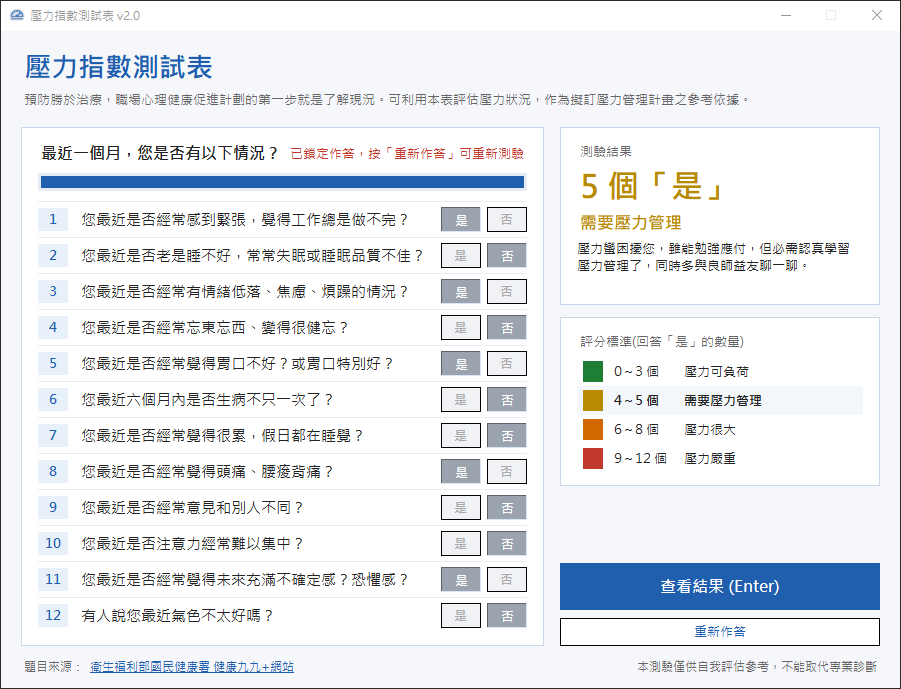

# 壓力指數測試表

回答 12 道職場壓力題目，依回答「是」的數量評估壓力程度，並給出對應的建議。

> 聯成電腦 Python 課程的練習作品，重新優化的版本。



題目與評分標準來源：[衛生福利部國民健康署 健康九九+網站 — 壓力指數測試](https://health99.hpa.gov.tw/health99/HC/D/115/StressIndex)

## 功能

- 12 道題目以「是／否」按鈕作答，選取的按鈕會變成藍色，上方**進度條**即時顯示作答進度
- 按「查看結果」後，右側顯示「是」的數量、壓力等級與建議，並依等級以**綠、黃、橘、紅**標色
- 評分標準中**標示所屬等級**，一眼看出落在哪個區間
- 有題目未作答時，**紅色標示未答題號**並列出是第幾題
- 查看結果後**鎖定作答**，避免改了答案卻看到舊結果；按「重新作答」清除所有作答並解除鎖定
- 只用 Python 內建的 tkinter，**不需安裝任何套件**就能執行

---

## 安裝

### 1. 事前準備

| 項目 | 說明 |
|---|---|
| **Python 3.9 以上** | 到 [python.org](https://www.python.org/downloads/) 下載，或安裝 [Anaconda](https://www.anaconda.com/download) |

### 2. 下載專案

```
git clone https://github.com/tedchen05/stress-index-test.git
cd stress-index-test
```

### 3. 安裝套件

執行程式**不需要安裝套件**。只有要打包成 exe 時，才需要安裝 PyInstaller：

```
pip install -r requirements.txt
```

> 使用 Anaconda 的話，請在「Anaconda Prompt」中執行。

---

## 執行

### 方法一：終端機

在專案資料夾執行：

```
python stress_gui.py
```

### 方法二：VS Code 按 F5

1. 用 VS Code 開啟專案資料夾（第一次開啟時，右下角會建議安裝 Python 擴充功能，按「安裝」）
2. 按 `Ctrl + Shift + P`，輸入 `Python: Select Interpreter`，選擇要使用的 Python
3. 按 **F5**

在「執行與偵錯」面板（`Ctrl + Shift + D`）上方可以切換：

| 選項 | 作用 |
|---|---|
| 執行壓力指數測試表 | 開啟測驗視窗（預設） |
| 執行目前開啟的檔案 | 執行目前正在編輯的檔案 |

### 打包成 exe

```
pip install pyinstaller
pyinstaller -F -w -n 壓力指數測試表 --icon images/icon.ico --add-data "images/icon.ico;images" stress_gui.py
```

產生的 `壓力指數測試表.exe` 在 `dist/` 資料夾，單獨一個檔案就能執行。

---

## 使用方式

1. 開啟程式，逐題點選「**是**」或「**否**」，上方進度條顯示已答題數
2. 全部作答後，按「**查看結果**」或直接按 Enter
3. 右側顯示「是」的數量、壓力等級與建議，下方評分標準會標示所屬等級，此時作答按鈕會鎖定
4. 想重新測驗時按「**重新作答**」

> 本測驗僅供自我評估參考，不能取代專業診斷，如有身心不適請洽專業醫療人員。

---

## 評分標準

| 「是」的數量 | 壓力等級 | 建議 |
|---|---|---|
| 0～3 個 | 壓力可負荷 | 壓力指數還在能負荷的範圍 |
| 4～5 個 | 需要壓力管理 | 認真學習壓力管理，多與良師益友聊一聊 |
| 6～8 個 | 壓力很大 | 尋求心理衛生專業人員，接受系統性的心理治療 |
| 9～12 個 | 壓力嚴重 | 看精神專科醫師，接受藥物治療與心理治療 |

題目、評分標準與建議文字都集中在 `stress_core.py`，要修改只需改這個檔案。

---

## 常見問題

**Q：按「查看結果」出現「尚未完成」？**
還有題目沒作答，左側紅色題號就是未答的題目，作答後再按一次即可。

**Q：查看結果後，「是／否」按鈕點不動？**
查看結果後會鎖定作答，按「重新作答」即可重新測驗。

**Q：執行時出現 `No module named tkinter`？**
部分精簡版 Python 未附 tkinter，請改用 Anaconda 或從 python.org 下載的官方安裝版。

**Q：打包後的 exe 開啟時跳出黑色命令列視窗？**
打包時要加上 `-w` 參數，照上方「打包成 exe」的指令執行即可。

**Q：exe 的標題列沒有顯示程式圖示？**
打包時要加上 `--add-data "images/icon.ico;images"`，把圖示一起打包進 exe。

---

## 檔案說明

```
stress-index-test/
├── stress_gui.py          # 視窗介面（主程式，執行這個）
├── stress_core.py         # 核心功能：題目、評分標準、計算結果
├── requirements.txt       # 打包 exe 需要的套件
├── images/
│   ├── icon.ico           # 程式圖示（exe 與視窗標題列）
│   └── screenshot.png     # 介面截圖
└── .vscode/
    ├── launch.json        # VS Code 按 F5 的執行設定
    └── extensions.json    # 建議安裝的 VS Code 擴充功能
```
